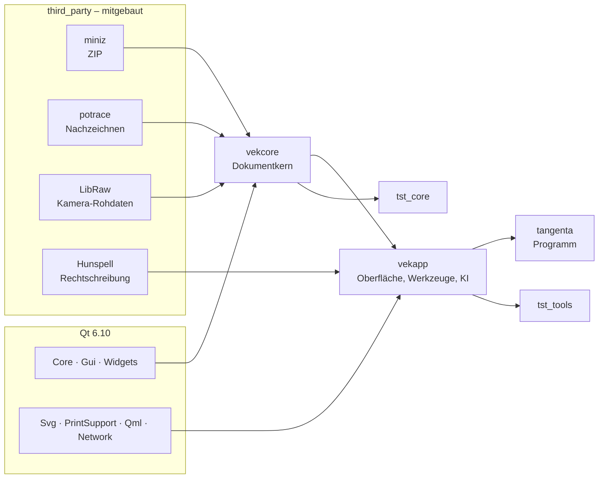
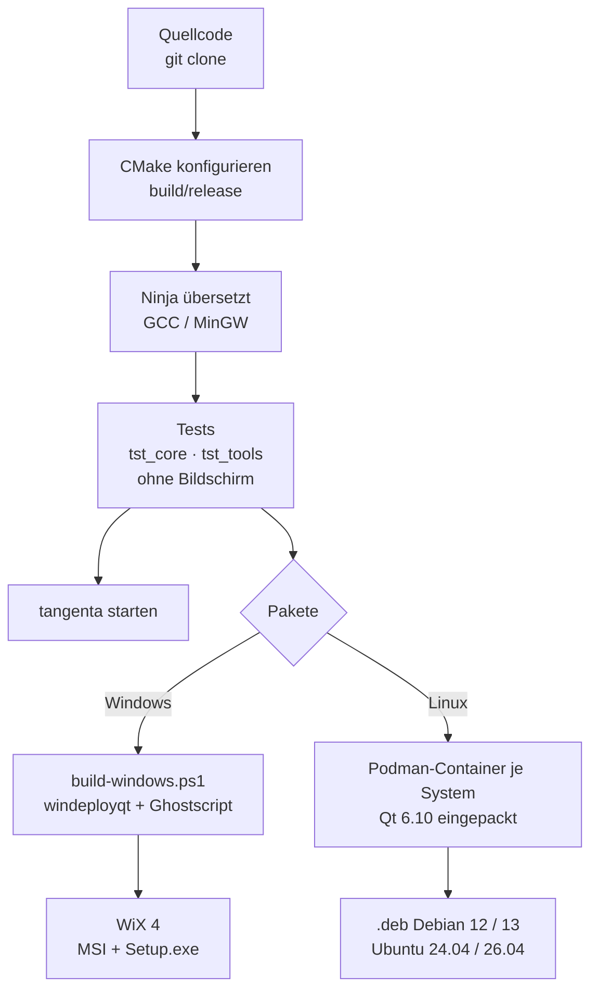
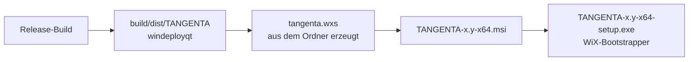
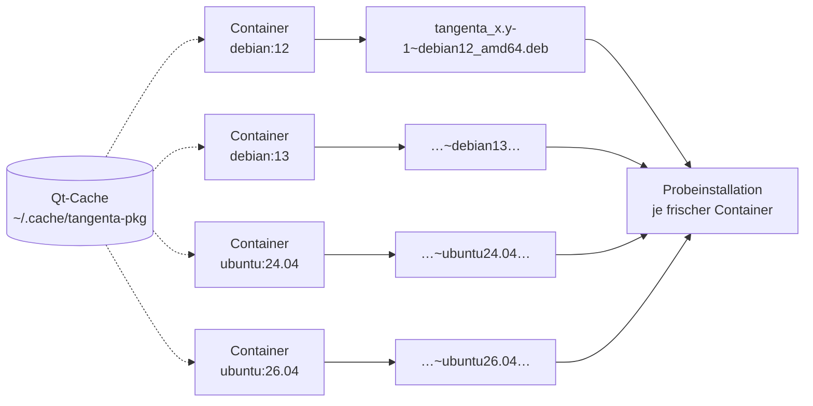

# TANGENTA bauen

Diese Anleitung führt Schritt für Schritt von einem leeren Rechner zu einem selbst gebauten TANGENTA,
unter **Windows** und unter **Linux** (Debian, Ubuntu). Programmiererfahrung ist nicht nötig. Sie
müssen nur Befehle in ein Terminal kopieren können. Nach jedem Schritt steht, woran Sie erkennen, dass
er geklappt hat.

Am Ende gibt es auch die Installationspakete: MSI und Setup.exe für Windows, .deb für Debian und
Ubuntu.

**Inhalt**

1. [Was entsteht und wie](#1-was-entsteht-und-wie)
2. [Was Sie brauchen](#2-was-sie-brauchen)
3. [Windows Schritt für Schritt](#3-windows-schritt-für-schritt)
4. [Linux Schritt für Schritt](#4-linux-schritt-für-schritt)
5. [Installationspakete](#5-installationspakete)
6. [Tests](#6-tests)
7. [Mit einer Entwicklungsumgebung arbeiten](#7-mit-einer-entwicklungsumgebung-arbeiten)
8. [Häufige Probleme](#8-häufige-probleme)

**Kurzfassung für Eilige**, wenn alle Werkzeuge schon da sind:

| | Windows | Linux |
|---|---|---|
| Werkzeuge einrichten | `mingw32-make deps` | `make deps` (zeigt den apt-Befehl) |
| Bauen und testen | `mingw32-make test` | `make test` |
| Starten | `mingw32-make run` | `make run` |
| Pakete | `mingw32-make packages` | `make packages` |

---

## 1. Was entsteht und wie

TANGENTA ist ein C++20-Programm auf **Qt 6**, einer Bibliothek für Fenster, Grafik und Netz. Der
Kern (`vekcore`) kennt keine Fenster. Er enthält Dokument, Rückgängig, Dateiformat, Geometrie und
Import/Export. Die Oberfläche (`vekapp`) setzt darauf auf.

Vier kleinere Bibliotheken liegen im Quellcode bei (`third_party/`) und werden automatisch mitgebaut.
Darum müssen Sie sich nicht kümmern.



So arbeiten die Werkzeuge zusammen:

- **CMake** liest die Bauanleitung `CMakeLists.txt` und schreibt daraus Aufträge für Ninja.
- **Ninja** ruft den **Compiler** (GCC; unter Windows dessen Ausgabe MinGW) für jede Datei auf, so
  viele gleichzeitig, wie der Prozessor Kerne hat.
- Das **Makefile** fasst die langen Befehle zu kurzen Abkürzungen zusammen: `make test`, `make run`.



## 2. Was Sie brauchen

**Rechner**

| | Mindestens | Empfohlen |
|---|---|---|
| Betriebssystem | Windows 10 (64 Bit), Debian 12, Ubuntu 24.04 | Windows 11, Debian 13, Ubuntu 26.04 |
| Arbeitsspeicher | 8 GB | 16 GB |
| Freier Speicher | 6 GB | 10 GB (mit Paketbau) |
| Internet | für die Downloads (rund 1,5 GB); beim ersten Einrichten lädt CMake zudem libcdr, librevenge und Little CMS (zusammen 2 MB, Prüfsumme fest) | |

Der erste Bau dauert je nach Rechner 5 bis 20 Minuten, jeder weitere nur Sekunden bis wenige Minuten,
weil nur Geändertes neu übersetzt wird.

**Werkzeuge im Überblick** (die Abschnitte 3 und 4 zeigen, wie Sie sie installieren)

| Werkzeug | Version | Wofür | Bezugsquelle |
|---|---|---|---|
| Git | aktuell | Quellcode holen | https://git-scm.com/downloads |
| Python | 3.10 oder neuer | Hilfsprogramme installieren (aqtinstall, CMake, Ninja) | https://www.python.org/downloads/ |
| CMake | 3.21 oder neuer | Bauanleitung auswerten | https://cmake.org/download/ oder `pip` |
| Ninja | 1.10 oder neuer | Übersetzen steuern | https://ninja-build.org/ oder `pip` |
| Qt | 6.10.3 (mindestens 6.5) | Bibliothek für die Oberfläche | https://www.qt.io/ über aqtinstall (`pip`) |
| Compiler | Windows: MinGW 13.1, Linux: GCC 12+ | C++ übersetzen | über aqtinstall bzw. `apt` |
| GNU Make | 4.x | kurze Befehle (`make test`) | Windows: bei MinGW dabei, Linux: `apt` |
| aqtinstall | aktuell | lädt Qt und MinGW ohne Konto | https://github.com/miurahr/aqtinstall (`pip`) |

Nur für die **Installationspakete** (Abschnitt 5):

| Werkzeug | Version | Wofür | Bezugsquelle |
|---|---|---|---|
| 7-Zip | aktuell | Ghostscript auspacken (Windows) | https://www.7-zip.org/ |
| .NET SDK | 8 | Grundlage für WiX (Windows) | https://dotnet.microsoft.com/download |
| WiX Toolset | 4.0.6 | MSI und Setup.exe bauen (Windows) | https://wixtoolset.org/ über `dotnet tool` |
| Podman oder Docker | 4 oder neuer | .deb in Containern bauen (Linux) | `apt install podman` |

Ghostscript (für den Import von EPS/PS) lädt das Windows-Skript beim ersten Mal selbst herunter,
Version 10.08.0 von https://github.com/ArtifexSoftware/ghostpdl-downloads. Unter Linux nutzt
TANGENTA das Ghostscript des Systems (`libgs10`).

---

## 3. Windows Schritt für Schritt

Alles in diesem Abschnitt geht **ohne Administratorrechte** (ausser 7-Zip und .NET für die Pakete).
Qt und MinGW landen in Ihrem Benutzerordner unter `%USERPROFILE%\Qt`, also zum Beispiel
`C:\Users\Anna\Qt`.

### 3.1 Ein Terminal öffnen

Alle Befehle tippen oder kopieren Sie in **PowerShell**:

1. Windows-Taste drücken, `PowerShell` tippen, **Windows PowerShell** anklicken.
2. Es öffnet sich ein Fenster mit einer Zeile wie `PS C:\Users\Anna>`. Dort fügen Sie Befehle mit
   Rechtsklick ein und bestätigen mit Enter.

> Nach dem Installieren eines Programms kennt ein **bereits offenes** Terminal es oft noch nicht.
> Schliessen Sie es dann und öffnen Sie ein neues.

### 3.2 Git installieren

1. https://git-scm.com/download/win öffnen, **64-bit Git for Windows Setup** herunterladen und
   starten.
2. Alle Vorgaben mit **Next** übernehmen, am Ende **Install**.

Prüfen (in einem neuen PowerShell-Fenster):

```powershell
git --version
```

Richtig ist eine Antwort wie `git version 2.54.0.windows.1`.

### 3.3 Python installieren

1. https://www.python.org/downloads/windows/ öffnen und den neuesten **Windows installer (64-bit)**
   von Python 3 herunterladen.
2. Im ersten Fenster des Installers **unten das Häkchen „Add python.exe to PATH“ setzen**. Das ist
   der wichtigste Klick dieser Anleitung.
3. **Install Now** wählen.

Prüfen:

```powershell
python --version
```

Richtig ist zum Beispiel `Python 3.13.13`. Öffnet sich stattdessen der Microsoft Store, ist das der
Platzhalter von Windows: unter **Einstellungen > Apps > Erweiterte App-Einstellungen >
App-Ausführungsaliase** die beiden Schalter für `python.exe` und `python3.exe` ausschalten, dann
ein neues Terminal öffnen.

> **Alternative für Git und Python:** Windows 10/11 bringt die Paketverwaltung `winget` mit:
> `winget install Git.Git Python.Python.3.13`. Danach ein neues Terminal öffnen und wie oben prüfen.

### 3.4 CMake, Ninja und aqtinstall installieren

Diese drei Hilfsprogramme holt Python selbst:

```powershell
python -m pip install --user aqtinstall cmake ninja
```

Prüfen:

```powershell
python -m cmake --version
python -m aqt version
```

Richtig sind Antworten wie `cmake version 4.4.4` und `aqtinstall(aqt) v3.3.0 on Python 3.13.13` (die Versionsnummern dürfen höher sein).
Eine gelbe Warnung von pip, ein Ordner sei „not on PATH“, können Sie übergehen. TANGENTA ruft die
Programme immer über `python -m` auf.

### 3.5 Qt und den Compiler MinGW installieren

aqtinstall lädt beide direkt vom offiziellen Qt-Server, ganz ohne Qt-Konto. Ausgepackt sind das rund 1,8 GB, der Download ist kleiner. Das
dauert je nach Leitung 5 bis 15 Minuten:

```powershell
python -m aqt install-qt windows desktop 6.10.3 win64_mingw -m qtimageformats -O $env:USERPROFILE\Qt
python -m aqt install-tool windows desktop tools_mingw1310 qt.tools.win64_mingw1310 -O $env:USERPROFILE\Qt
```

Prüfen:

```powershell
Test-Path $env:USERPROFILE\Qt\6.10.3\mingw_64\bin\Qt6Core.dll
Test-Path $env:USERPROFILE\Qt\Tools\mingw1310_64\bin\g++.exe
```

Beide Zeilen müssen `True` ausgeben.

> Wer lieber den grafischen **Qt Online Installer** nimmt (https://www.qt.io/download-qt-installer,
> braucht ein kostenloses Qt-Konto): Wählen Sie dort **Qt 6.10.3 > MinGW 13.1.0 64-bit** und
> **Qt Image Formats**, unter **Developer and Designer Tools** zusätzlich **MinGW 13.1.0 64-bit**.
> Installieren Sie nach `C:\Users\<Name>\Qt`, dann passen alle Pfade dieser Anleitung.

### 3.6 Den Compiler dauerhaft bekannt machen

Damit `mingw32-make` und `g++` in jedem Terminal funktionieren, nehmen Sie den MinGW-Ordner in den
Suchpfad (`PATH`) Ihres Benutzers auf. Der Befehl ändert nur Ihren eigenen Benutzer:

```powershell
$mingw = "$env:USERPROFILE\Qt\Tools\mingw1310_64\bin"
[Environment]::SetEnvironmentVariable('Path', [Environment]::GetEnvironmentVariable('Path', 'User') + ";$mingw", 'User')
```

Von Hand geht es so: Windows-Taste, `Umgebungsvariablen` tippen, **Umgebungsvariablen für dieses
Konto bearbeiten** öffnen. Oben **Path** wählen, **Bearbeiten**, **Neu** und den Ordner
`C:\Users\<Name>\Qt\Tools\mingw1310_64\bin` eintragen.

Jetzt **ein neues PowerShell-Fenster öffnen** und prüfen:

```powershell
mingw32-make --version
g++ --version
```

Richtig sind `GNU Make 4.2.1` und `g++.exe (x86_64-posix-seh-rev1, Built by MinGW-Builds project) 13.1.0`.

### 3.7 Den Quellcode holen

Legen Sie einen Arbeitsordner an. Am besten wählen Sie einen kurzen Pfad ohne Leerzeichen auf der
eigenen Festplatte, zum Beispiel `C:\dev`:

```powershell
mkdir C:\dev
cd C:\dev
git clone https://github.com/roli8200/tangenta.git
cd tangenta
```

Prüfen: `dir` zeigt unter anderem `CMakeLists.txt`, `Makefile`, `src` und `tests`.

So ist der Quellcode aufgeteilt:

```
src/core        Dokumentkern (Qt Core + Gui, keine Fenster)
src/app         Oberfläche: Hauptfenster, Zeichenfläche, Werkzeuge, Dialoge, KI
tests           tst_core (Modell), tst_tools (Bedienung mit echten Maus- und Tastenereignissen)
third_party     miniz, potrace, LibRaw, Hunspell
resources       Symbole, Programmzeichen, Wörterbücher, Silbentrennung, Schriften
packaging       Linux-Pakete (build-deb.sh, package-linux.sh)
tools           Windows-Skripte (dev.ps1, build-windows.ps1, package-windows.ps1) und Generatoren
docs            Architektur, Skript-API, Optionen
website         Webseite tangenta.ch
```

### 3.8 Bauen und testen

Im Ordner `C:\dev\tangenta`:

```powershell
mingw32-make test
```

Das richtet beim ersten Mal CMake ein, übersetzt alles nach `build\release` und lässt danach alle
Tests laufen. Während des Übersetzens zählt Ninja mit (`[123/265] Building CXX object …`).

Richtig ist am Ende eine Zeile wie diese (ältere CMake-Versionen schreiben noch `, 0 tests failed` dazu):

```
100% tests passed out of 2
```

Schlägt PowerShell mit „Ausführung von Skripts ist auf diesem System deaktiviert“ fehl, siehe
[Häufige Probleme](#8-häufige-probleme).

### 3.9 Starten

```powershell
mingw32-make run
```

TANGENTA öffnet sich. Ab jetzt reicht nach einer Änderung am Quellcode wieder `mingw32-make run`. Es
übersetzt nur, was sich geändert hat.

Weitere Abkürzungen:

```powershell
mingw32-make build                    # nur übersetzen
mingw32-make build BUILD_TYPE=Debug   # Fassung mit Debug-Informationen nach build\debug
mingw32-make clean                    # build-Ordner löschen, nächster Bau beginnt von vorn
mingw32-make help                     # alle Ziele
```

Ohne Make geht dasselbe mit PowerShell allein: `powershell -ExecutionPolicy Bypass -File
tools\dev.ps1 test` (statt `test` auch `build`, `run`, `clean`, `deps`).

<details>
<summary>Ganz von Hand, ohne Makefile und Skripte</summary>

```powershell
$env:PATH = "$env:USERPROFILE\Qt\Tools\mingw1310_64\bin;$env:USERPROFILE\Qt\6.10.3\mingw_64\bin;$env:PATH"
$ninja = python -c "import ninja,os;print(os.path.join(ninja.BIN_DIR,'ninja.exe'))"
python -m cmake -S . -B build\release -G Ninja "-DCMAKE_MAKE_PROGRAM=$ninja" -DCMAKE_BUILD_TYPE=Release `
    "-DCMAKE_PREFIX_PATH=$env:USERPROFILE\Qt\6.10.3\mingw_64" -DCMAKE_C_COMPILER=gcc -DCMAKE_CXX_COMPILER=g++
python -m cmake --build build\release
python -m cmake -E chdir build\release ctest --output-on-failure
```
</details>

### 3.10 Eine startfähige Fassung zum Weitergeben

`build\release\tangenta.exe` läuft nur auf Ihrem Rechner, weil es die Qt-Dateien unter
`%USERPROFILE%\Qt` sucht. Eine Fassung mit allem Nötigen im selben Ordner entsteht so:

1. **7-Zip** installieren (https://www.7-zip.org/, 64-bit x64). Es muss nach
   `C:\Program Files\7-Zip` installiert werden, das Skript sucht es dort. Dafür braucht es
   Administratorrechte.
2. Bauen:

   ```powershell
   mingw32-make dist
   ```

Ergebnis: `build\dist\TANGENTA` mit `tangenta.exe`, den Qt- und MinGW-DLLs, Ghostscript und den
Wörterbüchern. Den Ordner können Sie auf jeden Windows-10/11-Rechner kopieren und dort starten.

---

## 4. Linux Schritt für Schritt

Getestet sind Debian 12 und 13 sowie Ubuntu 24.04 und 26.04. Die Befehle laufen im **Terminal**
(unter GNOME: Taste Super, `Terminal` tippen). `sudo` fragt einmal nach Ihrem Passwort.

Welcher Weg passt?

| System | Qt des Systems | Weg |
|---|---|---|
| Debian 13, Ubuntu 26.04 | 6.8 oder neuer, reicht | **A**: alles aus `apt` |
| Debian 12, Ubuntu 24.04 | 6.4, zu alt (TANGENTA braucht 6.5) | **B**: Qt 6.10 über aqtinstall |

Welches System Sie haben, zeigt `cat /etc/os-release`.

### 4.A Debian 13 und Ubuntu 26.04

**Schritt 1: Werkzeuge und Bibliotheken installieren**

```sh
sudo apt update
sudo apt install git build-essential cmake ninja-build \
     qt6-base-dev qt6-svg-dev qt6-declarative-dev qt6-image-formats-plugins \
     libgl1-mesa-dev libxkbcommon-dev fonts-dejavu-core fonts-liberation libgs10
```

| Paket | Wofür |
|---|---|
| `git` | Quellcode holen |
| `build-essential` | Compiler GCC und `make` |
| `cmake`, `ninja-build` | Bauanleitung und Übersetzen |
| `qt6-base-dev`, `qt6-svg-dev`, `qt6-declarative-dev` | Qt mit SVG und der Skript-Engine |
| `qt6-image-formats-plugins` | TIFF, WebP und weitere Bildformate |
| `libgl1-mesa-dev`, `libxkbcommon-dev` | Grafik und Tastatur für Qt |
| `fonts-dejavu-core`, `fonts-liberation` | Schriften, die die Tests brauchen |
| `libgs10` | Ghostscript für den Import von EPS/PS |

Prüfen:

```sh
g++ --version     # g++ 14 oder neuer
cmake --version   # 3.31 oder neuer
```

**Schritt 2: Quellcode holen**

```sh
mkdir -p ~/dev && cd ~/dev
git clone https://github.com/roli8200/tangenta.git
cd tangenta
```

**Schritt 3: Bauen, testen, starten**

```sh
make test
make run
```

Richtig ist am Ende von `make test` eine Zeile wie `100% tests passed, 0 tests failed out of 2`.

**Schritt 4 (freiwillig): fest installieren**

```sh
sudo make install
```

Das legt TANGENTA nach `/usr/local` und richtet den Startmenü-Eintrag und die Symbole ein. Danach
startet es auch mit `tangenta` aus jedem Terminal.

### 4.B Debian 12 und Ubuntu 24.04

**Schritt 1: Werkzeuge installieren**

```sh
sudo apt update
sudo apt install git build-essential cmake ninja-build python3-venv \
     libgl1-mesa-dev libegl1 libxkbcommon-dev libxkbcommon-x11-0 libglib2.0-0 libfontconfig1 libdbus-1-3      libxcb-cursor0 fonts-dejavu-core fonts-liberation libgs10
```

Die Bibliotheken `libglib2.0-0`, `libfontconfig1`, `libdbus-1-3` und `libxkbcommon-x11-0` sind auf
einem Rechner mit Desktop meist schon da. Auf einem Server oder in einem Container fehlen sie, und
ohne sie bricht das Einrichten von CMake mit `Failed to scan target tangenta for QML imports` ab.

Unter Debian 12 heisst das Ghostscript-Paket ebenfalls `libgs10`.

**Schritt 2: Qt 6.10 holen**

aqtinstall läuft in einer eigenen Python-Umgebung unter `~/.aqt`, damit es nichts am System ändert.
Qt landet in `~/Qt` (rund 1 GB):

```sh
python3 -m venv ~/.aqt
~/.aqt/bin/pip install aqtinstall
~/.aqt/bin/aqt install-qt linux desktop 6.10.3 linux_gcc_64 -m qtimageformats -O ~/Qt
```

Prüfen: `ls ~/Qt/6.10.3/gcc_64/bin/qmake` zeigt die Datei an.

**Schritt 3: Quellcode holen**

```sh
mkdir -p ~/dev && cd ~/dev
git clone https://github.com/roli8200/tangenta.git
cd tangenta
```

**Schritt 4: Bauen, testen, starten**

Bei jedem `make`-Befehl geben Sie an, wo Qt liegt:

```sh
make test QT_DIR=~/Qt/6.10.3/gcc_64
make run  QT_DIR=~/Qt/6.10.3/gcc_64
```

> **TIFF fehlt beim Export:** Das TIFF-Plugin des offiziellen Qt braucht `libtiff.so.5`, und das
> gibt es auf Debian 12 und Ubuntu 24.04 nicht mehr. TANGENTA bietet TIFF dann beim Export einfach nicht
> an; alles andere funktioniert. Die fertigen .deb-Pakete bringen ein passendes Plugin mit.

Wer das nicht jedes Mal tippen will, legt es einmal fest:

```sh
echo 'export QT_DIR=$HOME/Qt/6.10.3/gcc_64' >> ~/.bashrc
source ~/.bashrc
make test
```

### 4.C Andere Distributionen

Fedora, Arch, openSUSE und andere sind nicht getestet, sollten aber gehen. Sie brauchen dieselben
Bestandteile wie in 4.A: GCC 12 oder neuer, CMake 3.21+, Ninja, Qt 6.5+ mit den Modulen Base, Svg,
Declarative (Qml) und Image Formats, OpenGL- und xkbcommon-Entwicklerdateien sowie die Schriften
DejaVu und Liberation. Ist das Qt der Distribution älter als 6.5, nehmen Sie Weg B.

---

## 5. Installationspakete

### 5.1 Windows: MSI und Setup.exe

**Einmalig einrichten** (zusätzlich zu Abschnitt 3 und zu 7-Zip aus 3.10):

1. **.NET SDK 8** installieren: https://dotnet.microsoft.com/download/dotnet/8.0, unter **SDK** den
   **Windows x64 Installer**. Prüfen mit `dotnet --version` (neues Terminal), Antwort `8.0.…`.
2. **WiX 4.0.6** und seine zwei Erweiterungen installieren:

   ```powershell
   dotnet tool install --global wix --version 4.0.6
   wix extension add -g WixToolset.UI.wixext/4.0.6
   wix extension add -g WixToolset.Bal.wixext/4.0.6
   ```

   Prüfen: `wix --version` antwortet `4.0.6+…`. Findet das Terminal `wix` nicht, ein neues öffnen.

**Bauen:**

```powershell
mingw32-make packages
```

Ergebnis in `build\packages`:

- `TANGENTA-<version>-x64.msi` für die Verteilung im Netzwerk
- `TANGENTA-<version>-x64-setup.exe` mit Assistent

`tools\package-windows.ps1` erzeugt aus dem Programmordner die WiX-Quellen (`build\wix\*.wxs`) und
baut daraus das MSI. Die Setup.exe entsteht aus dem MSI.



**Stille Installation**, zum Beispiel per GPO, Intune oder Skript:

| Aufgabe | Befehl |
|---|---|
| Setup still | `TANGENTA-0.86-x64-setup.exe /quiet` |
| Setup mit Fortschrittsanzeige, ohne Fragen | `TANGENTA-0.86-x64-setup.exe /passive` |
| Zielordner und Desktop-Verknüpfung | `TANGENTA-0.86-x64-setup.exe /quiet InstallFolder="D:\Programme\TANGENTA" DesktopShortcut=1` |
| Protokoll | `TANGENTA-0.86-x64-setup.exe /quiet /log C:\Temp\tangenta-setup.log` |
| Deinstallieren | `TANGENTA-0.86-x64-setup.exe /uninstall /quiet` |
| MSI still | `msiexec /i TANGENTA-0.86-x64.msi /qn` |
| MSI mit Zielordner | `msiexec /i TANGENTA-0.86-x64.msi /qn INSTALLFOLDER="D:\Programme\TANGENTA" DESKTOPSHORTCUT=1` |
| MSI mit Protokoll | `msiexec /i TANGENTA-0.86-x64.msi /qn /l*v C:\Temp\tangenta.log` |
| MSI entfernen | `msiexec /x TANGENTA-0.86-x64.msi /qn` |

Beide Pakete installieren für alle Benutzer nach `C:\Program Files\TANGENTA`. Das braucht
Administratorrechte. Sie legen einen Startmenü-Eintrag an und verknüpfen `.vek`-Dateien mit
TANGENTA. Eine neuere Version ersetzt eine ältere.

### 5.2 Linux: .deb für Debian und Ubuntu

Die Pakete entstehen in Containern. So bekommt jedes System ein passendes Paket, egal auf welchem
Linux Sie bauen. Sie brauchen nur Podman (oder Docker):

```sh
sudo apt install podman
make packages                      # alle: debian12 debian13 ubuntu24.04 ubuntu26.04
make packages DEB_TARGETS=debian12 # nur eines
```

Der erste Lauf lädt Qt und die Container-Abbilder und dauert rund 30 Minuten je System. Ergebnis in
`build/packages`, zum Beispiel `tangenta_0.86-1~debian12_amd64.deb`.

`packaging/linux/package-linux.sh` startet je System einen frischen Container. Darin läuft
`build-deb.sh`, das folgende Schritte macht:

1. Es installiert Compiler und Bibliotheken.
2. Es holt Qt 6.10.3 mit aqtinstall. Qt liegt danach in `~/.cache/tangenta-pkg` und wird von allen
   Containern geteilt.
3. Es baut TANGENTA und lässt **alle Tests** laufen.
4. Es legt die nötigen Qt-Bibliotheken und Plugins nach `/opt/tangenta`. Die Laufzeitpfade setzt es
   mit `patchelf`.
5. Die Paketabhängigkeiten ermittelt `dpkg-shlibdeps`; es erzeugt Steuerdatei und Skripte.

Danach installiert ein zweiter, leerer Container das Paket und prüft, ob alle Bibliotheken da sind
und das Programm startet.



Installieren und entfernen:

```sh
sudo apt install ./tangenta_0.86-1~debian12_amd64.deb
sudo apt remove tangenta
```

Das Paket legt das Programm samt eigenem Qt unter `/opt/tangenta` ab. Dazu kommen der Verweis
`/usr/bin/tangenta`, der Startmenü-Eintrag, die Symbole und der Dateityp `application/x-tangenta`
(`*.vek`).

---

## 6. Tests

| Test | Inhalt |
|---|---|
| `tst_core` | Dokumentmodell, Rückgängig, Dateiformat, Geometrie, Import/Export |
| `tst_tools` | Bedienung wie ein Mensch: echte Maus- und Tastenereignisse auf Fenster, Werkzeuge, Dialoge |

Beide laufen ohne Bildschirm (`QT_QPA_PLATFORM=offscreen`, setzt CTest selbst). Einzelne Tests
starten Sie direkt, zum Beispiel `build/release/tst_tools aiToolsAndMcp`.

Einige Tests brauchen das Netz oder Zugangsdaten. Sie laufen nur, wenn die passende Variable gesetzt
ist:

| Variable | Wirkung |
|---|---|
| `VEK_SCREENSHOT_DIR=<ordner>` | Bildschirmfotos der Oberfläche ablegen |
| `VEK_NETWORK_TESTS=1` | Bildersuche gegen Wikimedia Commons und Icons8 |
| `VEK_KEY_PIXABAY`, `VEK_KEY_PEXELS`, `VEK_KEY_UNSPLASH`, `VEK_KEY_MAGNIFIC` | Schlüsseltest gegen die Dienste |
| `VEK_MAGNIFIC_KEY` | ein echter (abgerechneter) Magnific-Download |
| `VEK_AI_LIVE=1` | KI über das installierte Claude Code (eigenes Abo) |

Wer etwas beiträgt: Jede neue Funktion bekommt einen Test in `tests/`, und `make test` muss vor jedem
Pull Request grün sein.

## 7. Mit einer Entwicklungsumgebung arbeiten

Zum Bauen genügt das Terminal. Zum Lesen und Ändern des Codes hilft eine Entwicklungsumgebung:

- **Qt Creator** (https://download.qt.io/official_releases/qtcreator/, kostenlos). **Datei > Datei
  oder Projekt öffnen** und `CMakeLists.txt` wählen. Unter **Bearbeiten > Einstellungen > Kits**
  einmal das Qt unter `…\Qt\6.10.3\mingw_64` (bzw. `~/Qt/6.10.3/gcc_64` oder das System-Qt) und den
  Compiler eintragen, falls Qt Creator sie nicht selbst findet.
- **Visual Studio Code** (https://code.visualstudio.com/) mit der Erweiterung **CMake Tools**. Ordner
  öffnen, als Kit den GCC aus MinGW bzw. des Systems wählen. In `.vscode/settings.json` den Qt-Pfad
  angeben: `"cmake.configureSettings": { "CMAKE_PREFIX_PATH": "C:/Users/<Name>/Qt/6.10.3/mingw_64" }`.

Wie der Code aufgebaut ist, steht in [docs/architektur.md](docs/architektur.md), die Skript-API in
[docs/skripte.md](docs/skripte.md).

## 8. Häufige Probleme

| Meldung | Ursache und Abhilfe |
|---|---|
| `python` öffnet den Microsoft Store | App-Ausführungsaliase ausschalten (Abschnitt 3.3) oder Python mit Häkchen „Add python.exe to PATH“ neu installieren. |
| `Die Benennung "mingw32-make" wurde nicht … erkannt` | MinGW-Ordner fehlt im `PATH` (Abschnitt 3.6), oder das Terminal war schon vorher offen: neues öffnen. |
| `… kann nicht geladen werden, da die Ausführung von Skripts auf diesem System deaktiviert ist` | Das Makefile umgeht das selbst. Wer `tools\*.ps1` direkt startet, nimmt `powershell -ExecutionPolicy Bypass -File tools\dev.ps1 test`. |
| `Qt fehlt unter …\Qt\6.10.3\mingw_64` | Abschnitt 3.5 ausführen oder prüfen, ob Qt unter einem anderen Ordner liegt. |
| `Could not find a package configuration file provided by "Qt6"` | CMake findet Qt nicht: unter Linux `QT_DIR=…/gcc_64` angeben (Weg B), unter Windows Qt nach `%USERPROFILE%\Qt` installieren. |
| `Failed to scan target tangenta for QML imports: 127` | Qt aus aqtinstall findet `libglib-2.0.so.0` nicht: die Paketliste aus 4.B Schritt 1 vollständig installieren. |
| `Could not find a configuration file for package "Qt6" … version: 6.4` | System-Qt zu alt: Weg B (Abschnitt 4.B). |
| Fehler nach einem Wechsel von Qt oder Compiler | Der alte CMake-Zwischenstand passt nicht mehr: `make clean` bzw. `mingw32-make clean`, dann neu bauen. |
| `qt.qpa.plugin: Could not load the Qt platform plugin "xcb"` | `sudo apt install libxcb-cursor0` |
| Tests mit Text schlagen fehl (Linux) | Schriften fehlen: `sudo apt install fonts-dejavu-core fonts-liberation` |
| Bau bricht mit „Speicher erschöpft“ oder `Killed` ab | Zu wenig Arbeitsspeicher für viele gleichzeitige Übersetzungen: `cmake --build build/release -j 2` |
| Bau ist sehr langsam (Windows) | Der Virenscanner prüft jede erzeugte Datei. Den Ordner `C:\dev` als Ausnahme eintragen hilft deutlich. Netzlaufwerke sind ebenfalls langsam. |
| `windeployqt` meldet dxcompiler.dll | Harmlos, TANGENTA braucht diese Dateien nicht. |
| `7z.exe` nicht gefunden (bei `dist`/`packages`) | 7-Zip nach `C:\Program Files\7-Zip` installieren (Abschnitt 3.10). |
| `wix` nicht gefunden | Neues Terminal öffnen. Sonst `%USERPROFILE%\.dotnet\tools` in den `PATH` aufnehmen. |
| `podman: command not found` | `sudo apt install podman` |

Hilft nichts davon, eröffnen Sie ein Issue auf https://github.com/roli8200/tangenta/issues. Geben Sie
dabei System, den Befehl und die letzten 30 Zeilen der Ausgabe an.
