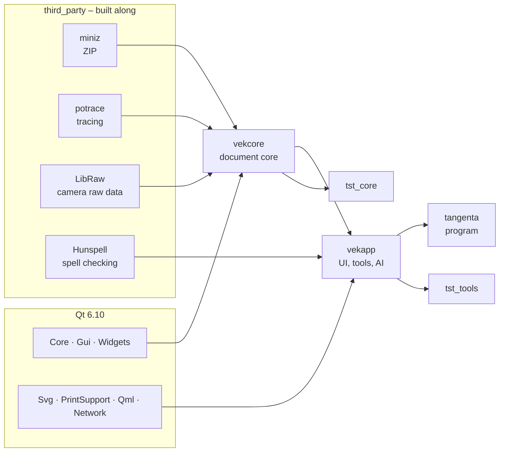
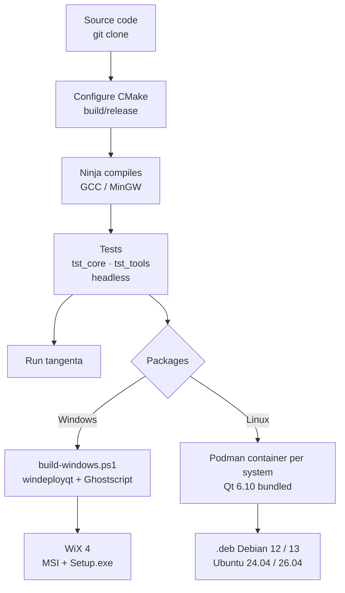
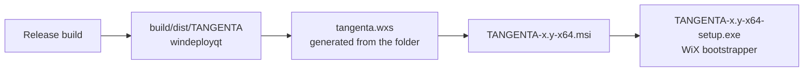
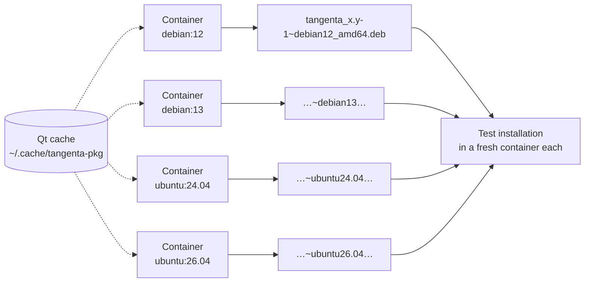

# Building TANGENTA

This guide takes you step by step from an empty computer to your own build of TANGENTA, on
**Windows** and on **Linux** (Debian, Ubuntu). No programming experience is needed. All you have to
do is copy commands into a terminal. After each step you will find out how to tell that it worked.

At the end you also get the installation packages: MSI and Setup.exe for Windows, .deb for Debian and
Ubuntu.

**Contents**

1. [What gets built and how](#1-what-gets-built-and-how)
2. [What you need](#2-what-you-need)
3. [Windows step by step](#3-windows-step-by-step)
4. [Linux step by step](#4-linux-step-by-step)
5. [Installation packages](#5-installation-packages)
6. [Tests](#6-tests)
7. [Working with an IDE](#7-working-with-an-ide)
8. [Common problems](#8-common-problems)

**Quick reference**, if all tools are already installed:

| | Windows | Linux |
|---|---|---|
| Set up tools | `mingw32-make deps` | `make deps` (prints the apt command) |
| Build and test | `mingw32-make test` | `make test` |
| Run | `mingw32-make run` | `make run` |
| Packages | `mingw32-make packages` | `make packages` |

---

## 1. What gets built and how

TANGENTA is a C++20 program built on **Qt 6**, a library for windows, graphics and networking. The
core (`vekcore`) knows nothing about windows. It contains the document, undo, the file format,
geometry and import/export. The user interface (`vekapp`) builds on top of it.

Four smaller libraries are bundled with the source code (`third_party/`) and are built
automatically. You do not need to take care of them.



This is how the tools work together:

- **CMake** reads the build description `CMakeLists.txt` and generates build jobs for Ninja from it.
- **Ninja** calls the **compiler** (GCC; on Windows its MinGW port) for each file, running as many
  jobs in parallel as the processor has cores.
- The **Makefile** wraps the long commands in short targets: `make test`, `make run`.



## 2. What you need

**Computer**

| | Minimum | Recommended |
|---|---|---|
| Operating system | Windows 10 (64-bit), Debian 12, Ubuntu 24.04 | Windows 11, Debian 13, Ubuntu 26.04 |
| RAM | 8 GB | 16 GB |
| Free disk space | 6 GB | 10 GB (with package builds) |
| Internet | for the downloads (about 1.5 GB); on first setup CMake also downloads libcdr, librevenge and Little CMS (2 MB in total, fixed checksum) | |

The first build takes 5 to 20 minutes depending on the computer; every later build only takes seconds
to a few minutes, because only what changed is recompiled.

**Tools at a glance** (sections 3 and 4 show how to install them)

| Tool | Version | Purpose | Source |
|---|---|---|---|
| Git | current | get the source code | https://git-scm.com/downloads |
| Python | 3.10 or newer | install helper programs (aqtinstall, CMake, Ninja) | https://www.python.org/downloads/ |
| CMake | 3.21 or newer | process the build description | https://cmake.org/download/ or `pip` |
| Ninja | 1.10 or newer | drive the compilation | https://ninja-build.org/ or `pip` |
| Qt | 6.10.3 (at least 6.5) | user interface library | https://www.qt.io/ via aqtinstall (`pip`) |
| Compiler | Windows: MinGW 13.1, Linux: GCC 12+ | compile C++ | via aqtinstall or `apt` |
| GNU Make | 4.x | short commands (`make test`) | Windows: included with MinGW, Linux: `apt` |
| aqtinstall | current | downloads Qt and MinGW without an account | https://github.com/miurahr/aqtinstall (`pip`) |

Only for the **installation packages** (section 5):

| Tool | Version | Purpose | Source |
|---|---|---|---|
| 7-Zip | current | unpack Ghostscript (Windows) | https://www.7-zip.org/ |
| .NET SDK | 8 | required by WiX (Windows) | https://dotnet.microsoft.com/download |
| WiX Toolset | 4.0.6 | build MSI and Setup.exe (Windows) | https://wixtoolset.org/ via `dotnet tool` |
| Podman or Docker | 4 or newer | build .deb packages in containers (Linux) | `apt install podman` |

The Windows script downloads Ghostscript (for EPS/PS import) by itself the first time, version
10.08.0 from https://github.com/ArtifexSoftware/ghostpdl-downloads. On Linux, TANGENTA uses the
system Ghostscript (`libgs10`).

---

## 3. Windows step by step

Everything in this section works **without administrator rights** (except 7-Zip and .NET for the
packages). Qt and MinGW are installed in your user folder under `%USERPROFILE%\Qt`, for example
`C:\Users\Anna\Qt`.

### 3.1 Open a terminal

Type or paste all commands into **PowerShell**:

1. Press the Windows key, type `PowerShell`, click **Windows PowerShell**.
2. A window opens with a line like `PS C:\Users\Anna>`. Paste commands there with a right-click and
   confirm with Enter.

> After you install a program, a terminal that was **already open** often does not know about it
> yet. In that case, close it and open a new one.

### 3.2 Install Git

1. Open https://git-scm.com/download/win, download **64-bit Git for Windows Setup** and run it.
2. Accept all defaults with **Next**, then click **Install** at the end.

Check (in a new PowerShell window):

```powershell
git --version
```

The expected answer looks like `git version 2.54.0.windows.1`.

### 3.3 Install Python

1. Open https://www.python.org/downloads/windows/ and download the latest **Windows installer
   (64-bit)** of Python 3.
2. In the first window of the installer, **tick "Add python.exe to PATH" at the bottom**. This is
   the most important click in this guide.
3. Choose **Install Now**.

Check:

```powershell
python --version
```

The expected answer is, for example, `Python 3.13.13`. If the Microsoft Store opens instead, that is
the Windows placeholder: under **Settings > Apps > Advanced app settings > App execution aliases**,
turn off the two switches for `python.exe` and `python3.exe`, then open a new terminal.

> **Alternative for Git and Python:** Windows 10/11 ships with the package manager `winget`:
> `winget install Git.Git Python.Python.3.13`. Then open a new terminal and check as above.

### 3.4 Install CMake, Ninja and aqtinstall

Python fetches these three helper programs itself:

```powershell
python -m pip install --user aqtinstall cmake ninja
```

Check:

```powershell
python -m cmake --version
python -m aqt version
```

The expected answers look like `cmake version 4.4.4` and `aqtinstall(aqt) v3.3.0 on Python 3.13.13` (the version numbers may be higher).
You can ignore a yellow pip warning that a folder is "not on PATH". TANGENTA always calls these
programs via `python -m`.

### 3.5 Install Qt and the MinGW compiler

aqtinstall downloads both directly from the official Qt server, without a Qt account. Unpacked they take about 1.8 GB; the download is smaller. This
takes 5 to 15 minutes depending on your connection:

```powershell
python -m aqt install-qt windows desktop 6.10.3 win64_mingw -m qtimageformats -O $env:USERPROFILE\Qt
python -m aqt install-tool windows desktop tools_mingw1310 qt.tools.win64_mingw1310 -O $env:USERPROFILE\Qt
```

Check:

```powershell
Test-Path $env:USERPROFILE\Qt\6.10.3\mingw_64\bin\Qt6Core.dll
Test-Path $env:USERPROFILE\Qt\Tools\mingw1310_64\bin\g++.exe
```

Both lines must print `True`.

> If you prefer the graphical **Qt Online Installer** (https://www.qt.io/download-qt-installer,
> requires a free Qt account): select **Qt 6.10.3 > MinGW 13.1.0 64-bit** and **Qt Image Formats**,
> and under **Developer and Designer Tools** also **MinGW 13.1.0 64-bit**. Install to
> `C:\Users\<Name>\Qt`; then all paths in this guide match.

### 3.6 Make the compiler permanently available

So that `mingw32-make` and `g++` work in every terminal, add the MinGW folder to your user's search
path (`PATH`). The command only changes your own user account:

```powershell
$mingw = "$env:USERPROFILE\Qt\Tools\mingw1310_64\bin"
[Environment]::SetEnvironmentVariable('Path', [Environment]::GetEnvironmentVariable('Path', 'User') + ";$mingw", 'User')
```

To do it by hand: press the Windows key, type `environment variables`, open **Edit environment
variables for your account**. Select **Path** at the top, click **Edit**, **New** and enter the folder
`C:\Users\<Name>\Qt\Tools\mingw1310_64\bin`.

Now **open a new PowerShell window** and check:

```powershell
mingw32-make --version
g++ --version
```

The expected answers are `GNU Make 4.2.1` and `g++.exe (x86_64-posix-seh-rev1, Built by MinGW-Builds project) 13.1.0`.

### 3.7 Get the source code

Create a working folder. A short path without spaces on a local drive works best, for example
`C:\dev`:

```powershell
mkdir C:\dev
cd C:\dev
git clone https://github.com/roli8200/tangenta.git
cd tangenta
```

Check: `dir` shows, among others, `CMakeLists.txt`, `Makefile`, `src` and `tests`.

This is how the source code is organized:

```
src/core        document core (Qt Core + Gui, no windows)
src/app         user interface: main window, canvas, tools, dialogs, AI
tests           tst_core (model), tst_tools (UI with real mouse and key events)
third_party     miniz, potrace, LibRaw, Hunspell
resources       icons, program logo, dictionaries, hyphenation, fonts
packaging       Linux packages (build-deb.sh, package-linux.sh)
tools           Windows scripts (dev.ps1, build-windows.ps1, package-windows.ps1) and generators
docs            architecture, script API, options
website         website tangenta.ch
```

### 3.8 Build and test

In the folder `C:\dev\tangenta`:

```powershell
mingw32-make test
```

On the first run this sets up CMake, compiles everything into `build\release` and then runs all
tests. While compiling, Ninja counts along (`[123/265] Building CXX object …`).

At the end you should see a line like this (older CMake versions also append `, 0 tests failed`):

```
100% tests passed out of 2
```

If PowerShell fails with "running scripts is disabled on this system", see
[Common problems](#8-common-problems).

### 3.9 Run

```powershell
mingw32-make run
```

TANGENTA opens. From now on, after changing the source code, `mingw32-make run` is all you need. It
only recompiles what has changed.

More shortcuts:

```powershell
mingw32-make build                    # compile only
mingw32-make build BUILD_TYPE=Debug   # build with debug information into build\debug
mingw32-make clean                    # delete the build folder, the next build starts from scratch
mingw32-make help                     # all targets
```

Without Make, the same works with PowerShell alone: `powershell -ExecutionPolicy Bypass -File
tools\dev.ps1 test` (instead of `test` also `build`, `run`, `clean`, `deps`).

<details>
<summary>Completely by hand, without Makefile and scripts</summary>

```powershell
$env:PATH = "$env:USERPROFILE\Qt\Tools\mingw1310_64\bin;$env:USERPROFILE\Qt\6.10.3\mingw_64\bin;$env:PATH"
$ninja = python -c "import ninja,os;print(os.path.join(ninja.BIN_DIR,'ninja.exe'))"
python -m cmake -S . -B build\release -G Ninja "-DCMAKE_MAKE_PROGRAM=$ninja" -DCMAKE_BUILD_TYPE=Release `
    "-DCMAKE_PREFIX_PATH=$env:USERPROFILE\Qt\6.10.3\mingw_64" -DCMAKE_C_COMPILER=gcc -DCMAKE_CXX_COMPILER=g++
python -m cmake --build build\release
python -m cmake -E chdir build\release ctest --output-on-failure
```
</details>

### 3.10 A portable build to pass on

`build\release\tangenta.exe` only runs on your own computer, because it looks for the Qt files under
`%USERPROFILE%\Qt`. A build with everything it needs in one folder is created like this:

1. Install **7-Zip** (https://www.7-zip.org/, 64-bit x64). It must be installed to
   `C:\Program Files\7-Zip`, because the script looks for it there. This requires administrator
   rights.
2. Build:

   ```powershell
   mingw32-make dist
   ```

Result: `build\dist\TANGENTA` with `tangenta.exe`, the Qt and MinGW DLLs, Ghostscript and the
dictionaries. You can copy this folder to any Windows 10/11 computer and run it there.

---

## 4. Linux step by step

Debian 12 and 13 as well as Ubuntu 24.04 and 26.04 are tested. The commands run in a **terminal**
(on GNOME: press Super, type `Terminal`). `sudo` asks for your password once.

Which path fits?

| System | System Qt | Path |
|---|---|---|
| Debian 13, Ubuntu 26.04 | 6.8 or newer, sufficient | **A**: everything from `apt` |
| Debian 12, Ubuntu 24.04 | 6.4, too old (TANGENTA needs 6.5) | **B**: Qt 6.10 via aqtinstall |

`cat /etc/os-release` shows which system you have.

### 4.A Debian 13 and Ubuntu 26.04

**Step 1: Install tools and libraries**

```sh
sudo apt update
sudo apt install git build-essential cmake ninja-build \
     qt6-base-dev qt6-svg-dev qt6-declarative-dev qt6-tools-dev qt6-image-formats-plugins \
     libgl1-mesa-dev libxkbcommon-dev fonts-dejavu-core fonts-liberation libgs10
```

| Package | Purpose |
|---|---|
| `git` | get the source code |
| `build-essential` | GCC compiler and `make` |
| `cmake`, `ninja-build` | build description and compilation |
| `qt6-base-dev`, `qt6-svg-dev`, `qt6-declarative-dev` | Qt with SVG and the script engine |
| `qt6-tools-dev` | translation tools (English, French and Italian interface) |
| `qt6-image-formats-plugins` | TIFF, WebP and other image formats |
| `libgl1-mesa-dev`, `libxkbcommon-dev` | graphics and keyboard for Qt |
| `fonts-dejavu-core`, `fonts-liberation` | fonts required by the tests |
| `libgs10` | Ghostscript for EPS/PS import |

Check:

```sh
g++ --version     # g++ 14 or newer
cmake --version   # 3.31 or newer
```

**Step 2: Get the source code**

```sh
mkdir -p ~/dev && cd ~/dev
git clone https://github.com/roli8200/tangenta.git
cd tangenta
```

**Step 3: Build, test, run**

```sh
make test
make run
```

At the end of `make test` you should see a line like `100% tests passed, 0 tests failed out of 2`.

**Step 4 (optional): Install permanently**

```sh
sudo make install
```

This installs TANGENTA to `/usr/local` and sets up the start menu entry and the icons. Afterwards it
also starts with `tangenta` from any terminal.

### 4.B Debian 12 and Ubuntu 24.04

**Step 1: Install tools**

```sh
sudo apt update
sudo apt install git build-essential cmake ninja-build python3-venv \
     libgl1-mesa-dev libegl1 libxkbcommon-dev libxkbcommon-x11-0 libglib2.0-0 libfontconfig1 libdbus-1-3      libxcb-cursor0 fonts-dejavu-core fonts-liberation libgs10
```

The libraries `libglib2.0-0`, `libfontconfig1`, `libdbus-1-3` and `libxkbcommon-x11-0` are usually
already present on a desktop machine. On a server or in a container they are missing, and without
them the CMake setup aborts with `Failed to scan target tangenta for QML imports`.

On Debian 12 the Ghostscript package is also called `libgs10`.

**Step 2: Get Qt 6.10**

aqtinstall runs in its own Python environment under `~/.aqt`, so it does not change anything on the
system. Qt is installed to `~/Qt` (about 1 GB):

```sh
python3 -m venv ~/.aqt
~/.aqt/bin/pip install aqtinstall
~/.aqt/bin/aqt install-qt linux desktop 6.10.3 linux_gcc_64 -m qtimageformats -O ~/Qt
```

Check: `ls ~/Qt/6.10.3/gcc_64/bin/qmake` lists the file.

**Step 3: Get the source code**

```sh
mkdir -p ~/dev && cd ~/dev
git clone https://github.com/roli8200/tangenta.git
cd tangenta
```

**Step 4: Build, test, run**

With every `make` command, specify where Qt is located:

```sh
make test QT_DIR=~/Qt/6.10.3/gcc_64
make run  QT_DIR=~/Qt/6.10.3/gcc_64
```

> **TIFF missing on export:** The TIFF plugin of the official Qt needs `libtiff.so.5`, which no
> longer exists on Debian 12 and Ubuntu 24.04. TANGENTA then simply does not offer TIFF on export;
> everything else works. The finished .deb packages ship a matching plugin.

If you do not want to type this every time, set it once:

```sh
echo 'export QT_DIR=$HOME/Qt/6.10.3/gcc_64' >> ~/.bashrc
source ~/.bashrc
make test
```

### 4.C Other distributions

Fedora, Arch, openSUSE and others are not tested but should work. You need the same components as in
4.A: GCC 12 or newer, CMake 3.21+, Ninja, Qt 6.5+ with the modules Base, Svg, Declarative (Qml) and
Image Formats, OpenGL and xkbcommon development files, and the DejaVu and Liberation fonts. If the
distribution's Qt is older than 6.5, use path B.

---

## 5. Installation packages

### 5.1 Windows: MSI and Setup.exe

**One-time setup** (in addition to section 3 and 7-Zip from 3.10):

1. Install the **.NET SDK 8**: https://dotnet.microsoft.com/download/dotnet/8.0, under **SDK** the
   **Windows x64 Installer**. Check with `dotnet --version` (new terminal); the answer is `8.0.…`.
2. Install **WiX 4.0.6** and its two extensions:

   ```powershell
   dotnet tool install --global wix --version 4.0.6
   wix extension add -g WixToolset.UI.wixext/4.0.6
   wix extension add -g WixToolset.Bal.wixext/4.0.6
   ```

   Check: `wix --version` answers `4.0.6+…`. If the terminal cannot find `wix`, open a new one.

**Build:**

```powershell
mingw32-make packages
```

Result in `build\packages`:

- `TANGENTA-<version>-x64.msi` for network deployment
- `TANGENTA-<version>-x64-setup.exe` with a setup wizard

`tools\package-windows.ps1` generates the WiX sources (`build\wix\*.wxs`) from the program folder and
builds the MSI from them. The Setup.exe is built from the MSI.



**Silent installation**, for example via GPO, Intune or a script:

| Task | Command |
|---|---|
| Setup, silent | `TANGENTA-0.86-x64-setup.exe /quiet` |
| Setup with progress bar, no questions | `TANGENTA-0.86-x64-setup.exe /passive` |
| Target folder and desktop shortcut | `TANGENTA-0.86-x64-setup.exe /quiet InstallFolder="D:\Programs\TANGENTA" DesktopShortcut=1` |
| Log file | `TANGENTA-0.86-x64-setup.exe /quiet /log C:\Temp\tangenta-setup.log` |
| Uninstall | `TANGENTA-0.86-x64-setup.exe /uninstall /quiet` |
| MSI, silent | `msiexec /i TANGENTA-0.86-x64.msi /qn` |
| MSI with target folder | `msiexec /i TANGENTA-0.86-x64.msi /qn INSTALLFOLDER="D:\Programs\TANGENTA" DESKTOPSHORTCUT=1` |
| MSI with log file | `msiexec /i TANGENTA-0.86-x64.msi /qn /l*v C:\Temp\tangenta.log` |
| Remove MSI | `msiexec /x TANGENTA-0.86-x64.msi /qn` |

Both packages install for all users to `C:\Program Files\TANGENTA`. This requires administrator
rights. They create a start menu entry and associate `.vek` files with TANGENTA. A newer version
replaces an older one.

### 5.2 Linux: .deb for Debian and Ubuntu

The packages are built in containers. That way every system gets a matching package, no matter which
Linux you build on. All you need is Podman (or Docker):

```sh
sudo apt install podman
make packages                      # all: debian12 debian13 ubuntu24.04 ubuntu26.04
make packages DEB_TARGETS=debian12 # just one
```

The first run downloads Qt and the container images and takes about 30 minutes per system. Result in
`build/packages`, for example `tangenta_0.86-1~debian12_amd64.deb`.

`packaging/linux/package-linux.sh` starts a fresh container for each system. Inside it runs
`build-deb.sh`, which performs the following steps:

1. It installs the compiler and libraries.
2. It fetches Qt 6.10.3 with aqtinstall. Qt is then kept in `~/.cache/tangenta-pkg` and shared by all
   containers.
3. It builds TANGENTA and runs **all tests**.
4. It copies the required Qt libraries and plugins to `/opt/tangenta` and sets the runtime paths with
   `patchelf`.
5. `dpkg-shlibdeps` determines the package dependencies; the script generates the control file and
   maintainer scripts.

Afterwards a second, empty container installs the package and checks that all libraries are present
and that the program starts.



Install and remove:

```sh
sudo apt install ./tangenta_0.86-1~debian12_amd64.deb
sudo apt remove tangenta
```

The package installs the program together with its own Qt under `/opt/tangenta`. In addition it adds
the link `/usr/bin/tangenta`, the start menu entry, the icons and the file type
`application/x-tangenta` (`*.vek`).

---

## 6. Tests

| Test | Content |
|---|---|
| `tst_core` | document model, undo, file format, geometry, import/export |
| `tst_tools` | UI tested the way a person uses it: real mouse and key events on windows, tools, dialogs |

Both run headless (`QT_QPA_PLATFORM=offscreen`, set by CTest itself). You can run individual tests
directly, for example `build/release/tst_tools aiToolsAndMcp`.

Some tests need network access or credentials. They only run when the corresponding variable is
set:

| Variable | Effect |
|---|---|
| `VEK_SCREENSHOT_DIR=<folder>` | save screenshots of the user interface |
| `VEK_NETWORK_TESTS=1` | image search against Wikimedia Commons and Icons8 |
| `VEK_KEY_PIXABAY`, `VEK_KEY_PEXELS`, `VEK_KEY_UNSPLASH`, `VEK_KEY_MAGNIFIC` | key check against the services |
| `VEK_MAGNIFIC_KEY` | a real (billed) Magnific download |
| `VEK_AI_LIVE=1` | AI via the installed Claude Code (your own subscription) |

For contributors: every new feature gets a test in `tests/`, and `make test` must pass before every
pull request.

## 7. Working with an IDE

The terminal is enough for building. For reading and changing the code, an IDE helps:

- **Qt Creator** (https://download.qt.io/official_releases/qtcreator/, free). **File > Open File
  or Project** and select `CMakeLists.txt`. Under **Edit > Preferences > Kits**, register the Qt
  under `…\Qt\6.10.3\mingw_64` (or `~/Qt/6.10.3/gcc_64` or the system Qt) and the compiler once, if
  Qt Creator does not find them by itself.
- **Visual Studio Code** (https://code.visualstudio.com/) with the **CMake Tools** extension. Open the
  folder and choose the MinGW GCC or the system GCC as the kit. Specify the Qt path in
  `.vscode/settings.json`: `"cmake.configureSettings": { "CMAKE_PREFIX_PATH": "C:/Users/<Name>/Qt/6.10.3/mingw_64" }`.

The structure of the code is described in [docs/architecture.md](docs/architecture.md), the script API
in [docs/scripting.md](docs/scripting.md).

## 8. Common problems

| Message | Cause and fix |
|---|---|
| `python` opens the Microsoft Store | Turn off the app execution aliases (section 3.3) or reinstall Python with "Add python.exe to PATH" ticked. |
| `The term 'mingw32-make' is not recognized …` | The MinGW folder is missing from `PATH` (section 3.6), or the terminal was already open before: open a new one. |
| `… cannot be loaded because running scripts is disabled on this system` | The Makefile works around this by itself. If you start `tools\*.ps1` directly, use `powershell -ExecutionPolicy Bypass -File tools\dev.ps1 test`. |
| `Qt fehlt unter …\Qt\6.10.3\mingw_64` | Run section 3.5 or check whether Qt is installed in a different folder. |
| `Could not find a package configuration file provided by "Qt6"` | CMake cannot find Qt: on Linux pass `QT_DIR=…/gcc_64` (path B), on Windows install Qt to `%USERPROFILE%\Qt`. |
| `Failed to scan target tangenta for QML imports: 127` | The Qt from aqtinstall cannot find `libglib-2.0.so.0`: install the full package list from 4.B step 1. |
| `Could not find a configuration file for package "Qt6" … version: 6.4` | System Qt too old: use path B (section 4.B). |
| Errors after switching Qt or the compiler | The old CMake cache no longer fits: `make clean` or `mingw32-make clean`, then build again. |
| `qt.qpa.plugin: Could not load the Qt platform plugin "xcb"` | `sudo apt install libxcb-cursor0` |
| Tests involving text fail (Linux) | Fonts are missing: `sudo apt install fonts-dejavu-core fonts-liberation` |
| Build aborts with "virtual memory exhausted" or `Killed` | Not enough RAM for many parallel compile jobs: `cmake --build build/release -j 2` |
| Build is very slow (Windows) | The virus scanner checks every generated file. Adding the folder `C:\dev` as an exclusion helps a lot. Network drives are slow as well. |
| `windeployqt` reports dxcompiler.dll | Harmless; TANGENTA does not need these files. |
| `7z.exe` not found (with `dist`/`packages`) | Install 7-Zip to `C:\Program Files\7-Zip` (section 3.10). |
| `wix` not found | Open a new terminal. Otherwise add `%USERPROFILE%\.dotnet\tools` to `PATH`. |
| `podman: command not found` | `sudo apt install podman` |

If none of this helps, open an issue at https://github.com/roli8200/tangenta/issues. Include your
system, the command and the last 30 lines of the output.
