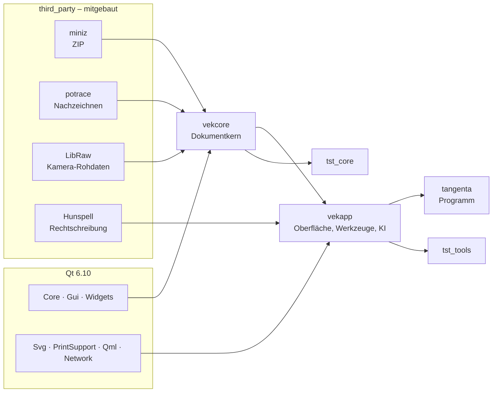
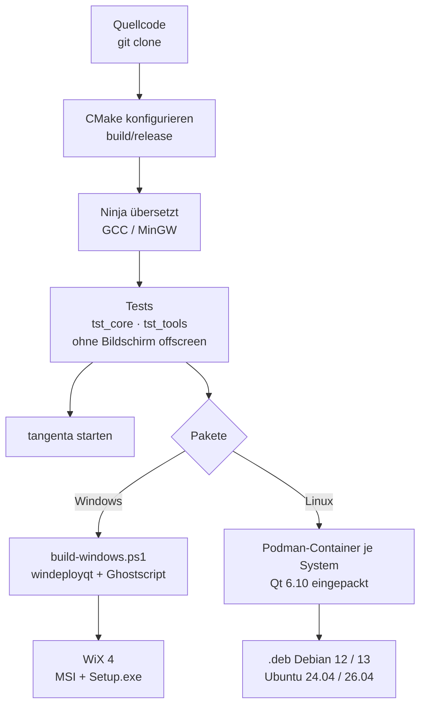
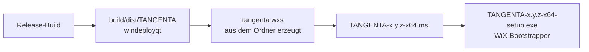
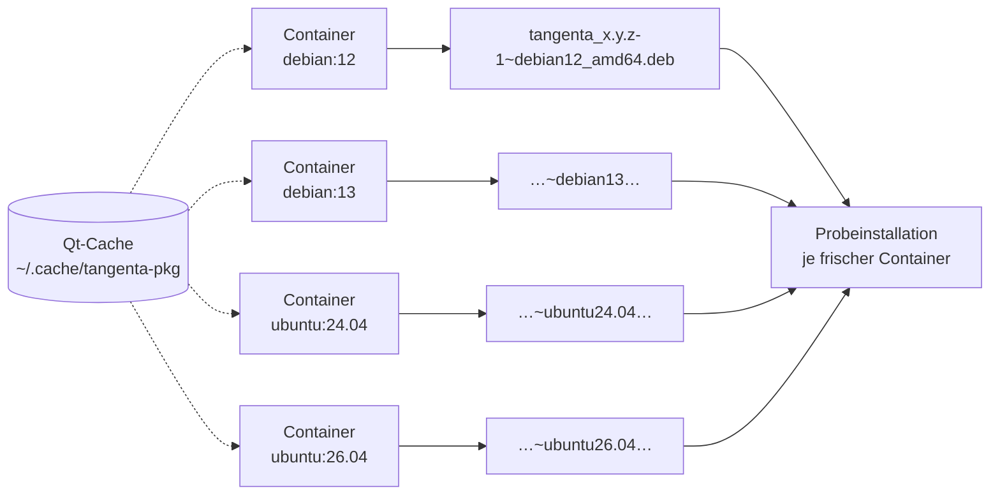

# TANGENTA bauen

Diese Anleitung beschreibt, wie TANGENTA unter **Windows** und **Linux** aus dem Quellcode entsteht.
Sie behandelt die Tests und die Installationspakete: MSI und Setup.exe für Windows, .deb für Debian
und Ubuntu.

Kurzfassung:

| | Windows | Linux |
|---|---|---|
| Werkzeuge einrichten | `mingw32-make deps` | `make deps` (zeigt den apt-Befehl) |
| Bauen und testen | `mingw32-make test` | `make test` |
| Starten | `mingw32-make run` | `make run` |
| Pakete | `mingw32-make packages` | `make packages` |

---

## 1. Überblick

TANGENTA ist ein C++20-Programm auf Qt 6. Der Kern (`vekcore`) kennt keine Fenster: Dokument,
Undo/Redo, Dateiformat, Geometrie und Import/Export. Die Oberfläche (`vekapp`) setzt darauf auf.
Dazu kommen vier eingebettete Bibliotheken, die mitgebaut werden. Systempakete braucht es dafür nicht.



Gebaut wird mit **CMake** und **Ninja**. Unter Windows kommt der Compiler aus **MinGW** (GCC 13),
unter Linux ist es der GCC der Distribution. Der Ablauf ist auf beiden Systemen derselbe:



## 2. Werkzeuge

| Werkzeug | Version | Wofür | Windows | Linux |
|---|---|---|---|---|
| Git | aktuell | Quellcode | https://git-scm.com/download/win | `sudo apt install git` |
| Python | 3.10+ | aqtinstall, CMake, Ninja (Windows) | https://www.python.org/downloads/windows/ | `sudo apt install python3 python3-venv` |
| CMake | 3.21+ | Build-Beschreibung | `pip install --user cmake` | `sudo apt install cmake` |
| Ninja | 1.10+ | Build-Werkzeug | `pip install --user ninja` | `sudo apt install ninja-build` |
| Qt | 6.10.3 (mind. 6.5) | Oberfläche | `aqt install-qt` (siehe unten) | System-Qt ab Debian 13/Ubuntu 26.04, sonst aqtinstall |
| Compiler | GCC 12+ / MinGW 13.1 | C++20 | `aqt install-tool … tools_mingw1310` | `sudo apt install build-essential` |
| GNU Make | 4.x | Abkürzungen (Makefile) | `mingw32-make` liegt bei MinGW | `sudo apt install make` |
| 7-Zip | aktuell | Ghostscript-DLL auspacken (nur `dist`/Pakete) | https://www.7-zip.org/ | – |
| .NET SDK | 6.0+ | WiX-Werkzeug | https://dotnet.microsoft.com/download | – |
| WiX Toolset | 4.0.6 | MSI und Setup.exe | `dotnet tool install --global wix --version 4.0.6` | – |
| Podman oder Docker | 4+ | .deb-Pakete in Containern | – | `sudo apt install podman` |

Ghostscript (EPS/PS-Import) lädt `tools/build-windows.ps1` beim ersten Lauf selbst herunter, Version
10.08.0 von https://github.com/ArtifexSoftware/ghostpdl-downloads. Unter Linux nutzt TANGENTA die
`libgs` des Systems; das Paket empfiehlt `libgs10`.

**Administratorrechte braucht unter Windows nichts davon.** Qt und MinGW landen in `%USERPROFILE%\Qt`,
die Python-Werkzeuge im Benutzerprofil.

## 3. Quellcode holen

```sh
git clone https://github.com/roli8200/tangenta.git
cd tangenta
```

```
src/core        Dokumentkern (Qt Core + Gui, keine Widgets)
src/app         Oberfläche: Hauptfenster, Zeichenfläche, Werkzeuge, Dialoge, KI
tests           tst_core (Modell), tst_tools (Bedienung mit echten Maus- und Tastenereignissen)
third_party     miniz, potrace, LibRaw, Hunspell
resources       Symbole, Programmzeichen, Wörterbücher, Silbentrennung, Schriften
packaging       Linux-Pakete (build-deb.sh, package-linux.sh)
tools           Windows-Skripte (dev.ps1, build-windows.ps1, package-windows.ps1) und Generatoren
docs            Architektur, Skript-API, Optionen
```

## 4. Windows

### 4.1 Einrichten (einmalig)

```bat
python -m pip install --user aqtinstall cmake ninja
python -m aqt install-qt windows desktop 6.10.3 win64_mingw -m qtimageformats -O %USERPROFILE%\Qt
python -m aqt install-tool windows desktop tools_mingw1310 qt.tools.win64_mingw1310 -O %USERPROFILE%\Qt
```

Danach `%USERPROFILE%\Qt\Tools\mingw1310_64\bin` in den `PATH` aufnehmen (für `mingw32-make`).
Dasselbe erledigt `mingw32-make deps` bzw. `tools\dev.ps1 deps`.

### 4.2 Bauen, testen, starten

```bat
mingw32-make test                 :: konfiguriert, baut build\release, lässt alle Tests laufen
mingw32-make run                  :: baut und startet
mingw32-make build BUILD_TYPE=Debug
```

Ohne Make geht dasselbe direkt mit PowerShell:

```bat
powershell -ExecutionPolicy Bypass -File tools\dev.ps1 test
```

Oder ganz von Hand:

```bat
set PATH=%USERPROFILE%\Qt\Tools\mingw1310_64\bin;%USERPROFILE%\Qt\6.10.3\mingw_64\bin;%PATH%
python -m cmake -S . -B build\release -G Ninja -DCMAKE_BUILD_TYPE=Release ^
    -DCMAKE_PREFIX_PATH=%USERPROFILE%\Qt\6.10.3\mingw_64 -DCMAKE_C_COMPILER=gcc -DCMAKE_CXX_COMPILER=g++
python -m cmake --build build\release
python -m cmake -E chdir build\release ctest --output-on-failure
```

### 4.3 Startfähige Fassung und Pakete

```bat
mingw32-make dist        :: build\dist\TANGENTA – Programm samt Qt, MinGW-Laufzeit, Ghostscript, Wörterbüchern
mingw32-make packages    :: build\packages\TANGENTA-<version>-x64.msi und ...-x64-setup.exe
```

`tools\package-windows.ps1` erzeugt aus dem Programmordner die WiX-Quellen (`build\wix\*.wxs`) und
baut daraus das MSI. Der Bootstrapper (Setup.exe) entsteht aus dem MSI. Einmalig nötig:

```bat
dotnet tool install --global wix --version 4.0.6
wix extension add -g WixToolset.UI.wixext/4.0.6
wix extension add -g WixToolset.Bal.wixext/4.0.6
```



### 4.4 Stille Installation

| Aufgabe | Befehl |
|---|---|
| Setup still | `TANGENTA-0.85-x64-setup.exe /quiet` |
| Setup mit Fortschrittsanzeige, ohne Fragen | `TANGENTA-0.85-x64-setup.exe /passive` |
| Zielordner und Desktop-Verknüpfung | `TANGENTA-0.85-x64-setup.exe /quiet InstallFolder="D:\Programme\TANGENTA" DesktopShortcut=1` |
| Protokoll | `TANGENTA-0.85-x64-setup.exe /quiet /log C:\Temp\tangenta-setup.log` |
| Deinstallieren | `TANGENTA-0.85-x64-setup.exe /uninstall /quiet` |
| MSI still | `msiexec /i TANGENTA-0.85-x64.msi /qn` |
| MSI mit Zielordner | `msiexec /i TANGENTA-0.85-x64.msi /qn INSTALLFOLDER="D:\Programme\TANGENTA" DESKTOPSHORTCUT=1` |
| MSI mit Protokoll | `msiexec /i TANGENTA-0.85-x64.msi /qn /l*v C:\Temp\tangenta.log` |
| MSI entfernen | `msiexec /x TANGENTA-0.85-x64.msi /qn` |

Beide Pakete installieren für alle Benutzer nach `C:\Program Files\TANGENTA`. Das braucht
Administratorrechte. Sie legen einen Startmenü-Eintrag an und verknüpfen `.vek`-Dateien mit
TANGENTA. Eine neuere Version ersetzt eine ältere (gleicher UpgradeCode).

## 5. Linux

### 5.1 Mit dem Qt des Systems (Debian 13, Ubuntu 26.04)

```sh
sudo apt install build-essential cmake ninja-build qt6-base-dev qt6-svg-dev qt6-declarative-dev \
     qt6-image-formats-plugins libgl1-mesa-dev libxkbcommon-dev
make test
make run
sudo make install            # nach /usr/local, mit Startmenü-Eintrag und Symbolen
```

### 5.2 Mit Qt 6.10 aus aqtinstall (Debian 12, Ubuntu 24.04)

Diese Systeme liefern nur Qt 6.4. TANGENTA braucht mindestens 6.5.

```sh
sudo apt install build-essential cmake ninja-build python3-venv libgl1-mesa-dev libxkbcommon-dev libxcb-cursor0
python3 -m venv ~/.aqt && ~/.aqt/bin/pip install aqtinstall
~/.aqt/bin/aqt install-qt linux desktop 6.10.3 linux_gcc_64 -m qtimageformats -O ~/Qt
make test QT_DIR=~/Qt/6.10.3/gcc_64
make run  QT_DIR=~/Qt/6.10.3/gcc_64
```

### 5.3 .deb-Pakete

```sh
sudo apt install podman            # oder Docker
make packages                      # alle: debian12 debian13 ubuntu24.04 ubuntu26.04
make packages DEB_TARGETS=debian12
```

`packaging/linux/package-linux.sh` startet je System einen frischen Container. Darin läuft
`build-deb.sh`, das folgende Schritte macht:

1. Es installiert Compiler und Bibliotheken.
2. Es holt Qt 6.10.3 mit aqtinstall. Qt liegt danach in `~/.cache/tangenta-pkg` und wird von allen
   Containern geteilt.
3. Es baut TANGENTA und lässt **alle Tests** laufen.
4. Es legt die nötigen Qt-Bibliotheken und Plugins nach `/opt/tangenta`. Die Laufzeitpfade setzt es
   mit `patchelf`.
5. Die Paketabhängigkeiten ermittelt `dpkg-shlibdeps`; es erzeugt Steuerdatei und Skripte.

Danach installiert ein zweiter, leerer Container das Paket und prüft, ob alle Bibliotheken da sind
und das Programm startet.



Installation und Entfernen:

```sh
sudo apt install ./tangenta_0.85-1~debian12_amd64.deb
sudo apt remove tangenta
```

Das Paket legt das Programm unter `/opt/tangenta` ab, mit eigenem Qt. Dazu kommen der Verweis
`/usr/bin/tangenta`, der Startmenü-Eintrag, die Symbole und der Dateityp `application/x-tangenta`
(`*.vek`).

## 6. Tests

| Test | Inhalt |
|---|---|
| `tst_core` | Dokumentmodell, Undo/Redo, Dateiformat, Geometrie, Import/Export |
| `tst_tools` | Bedienung wie ein Mensch: echte Maus- und Tastenereignisse auf Fenster, Werkzeuge, Dialoge |

Beide laufen ohne Bildschirm (`QT_QPA_PLATFORM=offscreen`, setzt CTest selbst). Einige Tests
brauchen das Netz oder Zugangsdaten. Sie laufen nur, wenn die passende Variable gesetzt ist:

| Variable | Wirkung |
|---|---|
| `VEK_SCREENSHOT_DIR=<ordner>` | Bildschirmfotos der Oberfläche ablegen |
| `VEK_NETWORK_TESTS=1` | Bildersuche gegen Wikimedia Commons und Icons8 |
| `VEK_KEY_PIXABAY`, `VEK_KEY_PEXELS`, `VEK_KEY_UNSPLASH`, `VEK_KEY_MAGNIFIC` | Schlüsseltest gegen die Dienste |
| `VEK_MAGNIFIC_KEY` | ein echter (abgerechneter) Magnific-Download |
| `VEK_AI_LIVE=1` | KI über das installierte Claude Code (eigenes Abo) |

Einzelne Tests: `build/release/tst_tools aiToolsAndMcp`.

## 7. Häufige Probleme

| Meldung | Ursache und Abhilfe |
|---|---|
| `Could not find a package configuration file provided by "Qt6"` | `CMAKE_PREFIX_PATH` bzw. `QT_DIR` zeigt nicht auf Qt (`…/6.10.3/mingw_64` oder `…/gcc_64`). |
| `Qt6 … version 6.4 … required 6.5` | System-Qt zu alt: Qt 6.10 mit aqtinstall (Abschnitt 5.2). |
| `qt.qpa.plugin: Could not load the Qt platform plugin "xcb"` | `sudo apt install libxcb-cursor0` |
| Tests mit Text schlagen fehl (Linux) | Schriften fehlen: `sudo apt install fonts-dejavu-core fonts-liberation` |
| `windeployqt` meldet dxcompiler.dll | Harmlos, TANGENTA braucht kein Direct3D-Shader-Compiling. |
| `wix` nicht gefunden | `%USERPROFILE%\.dotnet\tools` in den `PATH`, oder das Skript nimmt den vollen Pfad. |
| `mingw32-make` nicht gefunden | `%USERPROFILE%\Qt\Tools\mingw1310_64\bin` in den `PATH`. |
