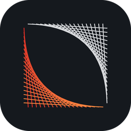
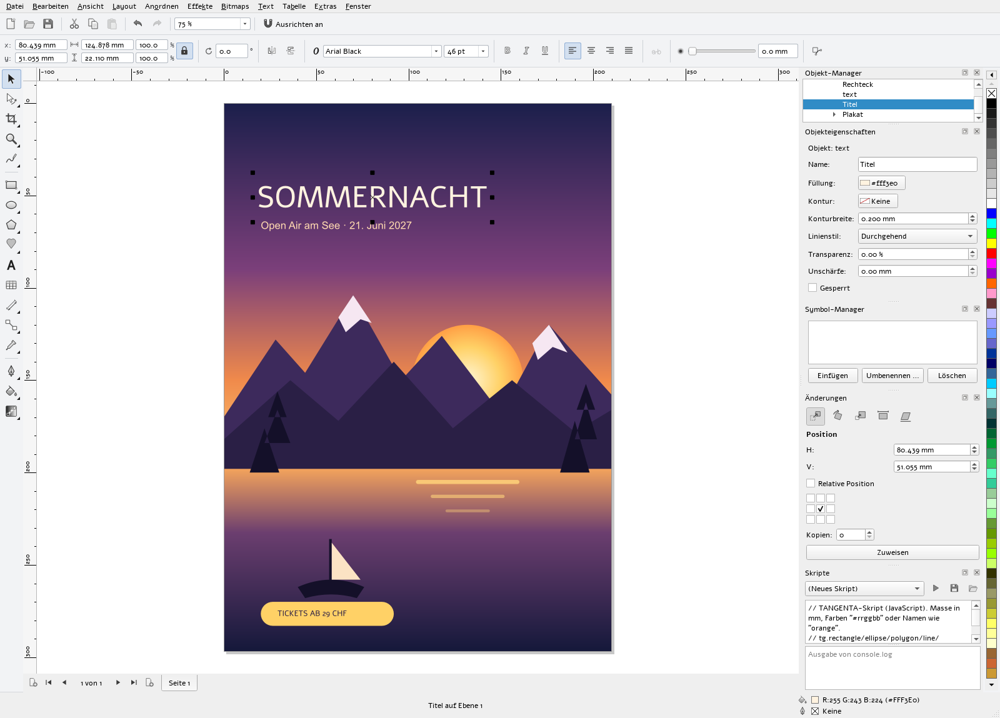
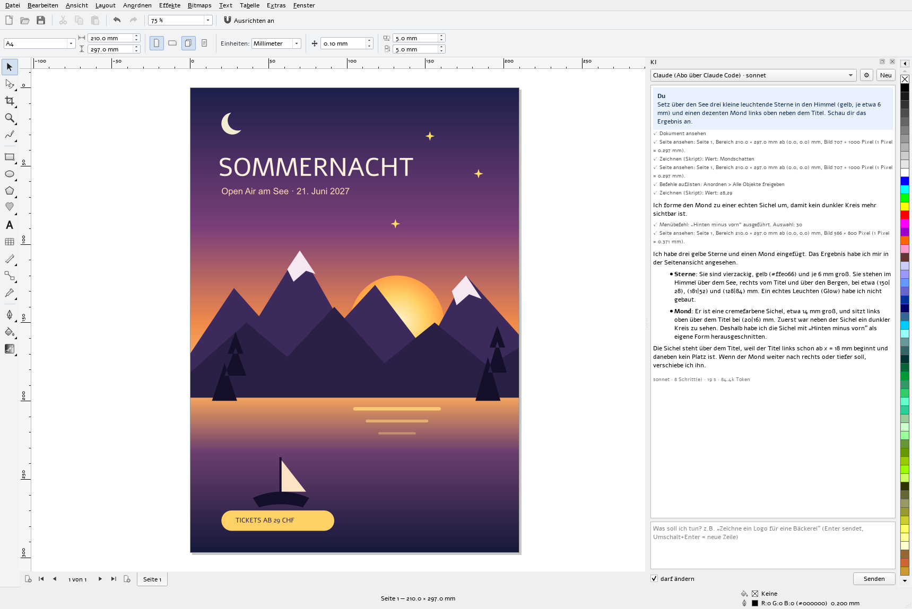
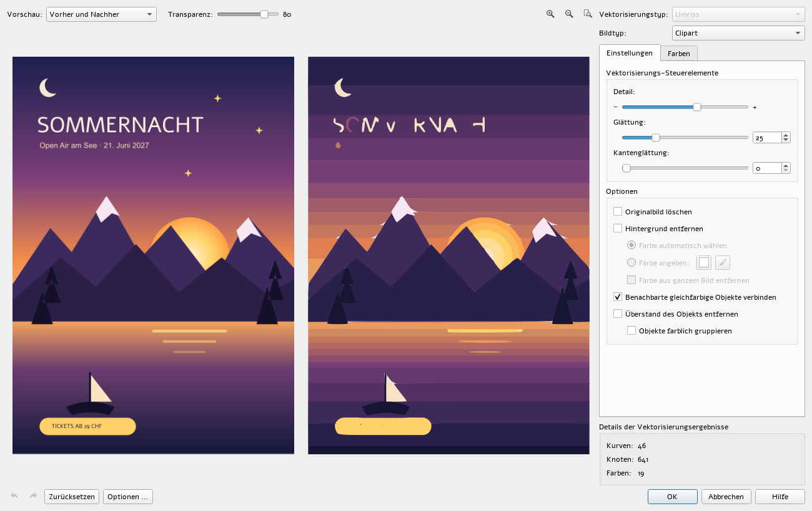
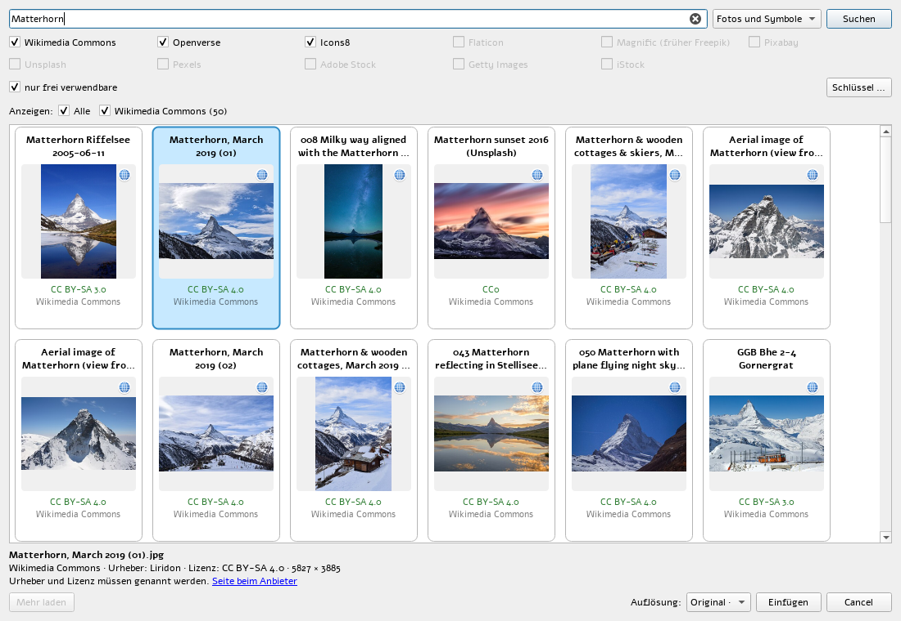

<p align="center">
  
</p>

<h1 align="center">TANGENTA</h1>

<p align="center">
  <b>Vector graphics the way you know it – free, for Windows and Linux, with a built-in AI assistant.</b>
</p>

<p align="center">
  <a href="https://github.com/roli8200/tangenta/releases/latest"></a>
  <a href="LICENSE"></a>
  
  
</p>

<p align="center">
  
</p>

---

## The tools you know. No subscription, no lock-in.

TANGENTA is made for people who have worked with classic vector graphics software for years. Menus,
shortcuts, dockers and tools sit where your hand expects them: F6 draws a rectangle, Ctrl+Q converts to
curves, G starts the interactive fill. Instead of license fees you get free software under the GPL.
Your files stay with you.

- **Familiar workflow**: standard toolbar and property bar, toolbox with flyouts, dockers and an
  Options dialog laid out the way you are used to.
- **Precise**: measurements in mm, number fields that calculate (`297/2`). Snapping to nodes, guides
  and the page, dynamic guides.
- **Fast and lean**: a native program in C++ and Qt 6. It starts in seconds and installs with one
  click or silently across the network.
- **Your language**: the interface speaks English, German, French, Italian, Spanish, Portuguese and Simplified Chinese (View > Language).
- **Open**: your document is a plain file. Opens CDR, CMX, PDF, AI, SVG, EPS and DXF. Exports PDF, SVG,
  EPS, DXF and all common image formats. Scripting in JavaScript.

## An AI assistant that really draws

<p align="center">
  
</p>

Say what you need and the assistant works directly in your document. For this picture it got just one
sentence: *"Put three small glowing stars in the sky and a subtle moon next to the title."* It looked at
the poster and drew the stars and the moon as vectors. It cut out the crescent with "Back Minus Front",
checked the result itself and then reported what it had done.

- **Draws real vectors**: shapes, text and whole illustrations as editable curves.
- **Operates TANGENTA**: group, align, weld shapes, convert to curves, trace bitmaps, export.
- **Sees what it does**: it looks at the page as an image and corrects itself.
- **Searches images and the web** and inserts photos with author and license.
- **One Ctrl+Z** undoes everything it changed in a single answer.
- **Your choice of provider**:
  - **Claude through your subscription** (Pro or Max, via Claude Code) without API costs.
  - Claude, OpenAI, Google Gemini or DeepSeek with your own API key.
  - Your own Ollama or LiteLLM server.
- **Read-only if you want**: without the "may edit" checkbox it touches nothing.

## Turn bitmaps into vectors

<p align="center">
  
</p>

**SuperTrace** traces logos, line art, clip art and photos. You see before and after side by side
and adjust detail, smoothing, number of colors and background live. Colors can be merged or replaced.
Quick Trace does the whole job with a single click.

## Millions of free images, right inside the program

<p align="center">
  
</p>

The **image search** queries several archives at once:
- without a key: Wikimedia Commons, Openverse and Icons8
- with your own key: Flaticon, Magnific (Freepik), Pixabay, Unsplash and Pexels

Every tile shows title, license and source; the globe opens the image's page. You choose the
resolution up to the original, and the credit is kept in the object name after inserting.

## Everything a graphic needs

| | |
|---|---|
| **Drawing** | rectangle, ellipse and arc, polygon and star, spiral, freehand, 2-point line, Bézier, artistic media, perfect shapes, tables, dimensions, connectors |
| **Shaping** | Shape tool with all node types, knife, eraser, crop, weld, intersect, trim, outline to object, join curves |
| **Fill and outline** | uniform, gradient, pattern, texture, mesh fill, interactive fill, arrowheads, line styles |
| **Effects** | blend, contour, extrude, envelope, perspective, drop shadow, transparency, lens, bevel, blur, SuperClip |
| **Text** | artistic and paragraph text, linked frames, text on path, bullets, drop caps, hyphenation, spell checking, QuickCorrect |
| **Bitmaps** | import up to camera raw files (NEF, CR2, CR3, ARW, DNG …), tone curve, brightness/contrast, color balance, filters, SuperTrace |
| **Document** | pages with master page, layers, object manager, symbols and clones, guides, grid, unlimited undo |
| **Exchange** | open: CDR, CMX, PDF, AI, SVG (including Inkscape), EPS/PS, DXF, images. Export: PDF, SVG, EPS, DXF, PNG, JPEG, TIFF, WebP, PSD, HTML |
| **Printing** | print preview, imposition for booklets and step-and-repeat |
| **Automation** | JavaScript scripting with editor and its own API, AI assistant |

The most important shortcuts and moves are listed in [docs/usage.md](docs/usage.md).

## Installation

### Windows 10 / 11

[Download the latest version](https://github.com/roli8200/tangenta/releases/latest). There are two
packages:
- `TANGENTA-<version>-x64-setup.exe` with a setup wizard
- `TANGENTA-<version>-x64.msi` for network deployment

Silent installation, e.g. via GPO, Intune or a script:

```bat
TANGENTA-0.86-x64-setup.exe /quiet
msiexec /i TANGENTA-0.86-x64.msi /qn INSTALLFOLDER="D:\Programs\TANGENTA" DESKTOPSHORTCUT=1
```

The packages are not signed yet. If Windows shows "Windows protected your PC", click *More info* →
*Run anyway*.

### Debian and Ubuntu

One package each for Debian 12, Debian 13, Ubuntu 24.04 and Ubuntu 26.04. Qt 6.10 is included.

```sh
sudo apt install ./tangenta_0.86-1.debian12_amd64.deb
```

### Other Linux systems (Flatpak)

For Fedora, openSUSE, Arch, Mint and every other system with Flatpak. Flatpak fetches the KDE runtime
(Qt 6.10) from Flathub during installation.

```sh
flatpak install --user TANGENTA-0.86-x86_64.flatpak
flatpak run ch.tangenta.Tangenta
```

Build it yourself: `packaging/flatpak/build-flatpak.sh` (needs `flatpak` and `flatpak-builder`).

### Build from source

The complete toolchain is described in [BUILD.md](BUILD.md), with diagrams of the process. In short:

```sh
make test && make run              # Linux
mingw32-make test                  # Windows
```

## Contributing

Bug reports, feature requests and pull requests are welcome. Every feature has a test in `tests/` that
operates the program like a person would: with real mouse and keyboard events, without a screen. The
architecture is described in [docs/architecture.md](docs/architecture.md), the scripting API in
[docs/scripting.md](docs/scripting.md).

## License

TANGENTA is free software under the [GNU General Public License 3.0 or later](LICENSE).
Bundled with it:
- [miniz](https://github.com/richgel999/miniz) (MIT)
- [Potrace](https://potrace.sourceforge.net/) (GPL)
- [LibRaw](https://www.libraw.org/) (LGPL/CDDL)
- [Hunspell](https://hunspell.github.io/) (LGPL/MPL)
- [libcdr](https://wiki.documentfoundation.org/DLP/Libraries/libcdr) and librevenge (MPL 2.0) for CDR and CMX files
- [Little CMS](https://www.littlecms.com/) (MIT)

For EPS/PS import TANGENTA uses [Ghostscript](https://www.ghostscript.com/) (AGPL).

The photos in the image search above come from Wikimedia Commons; license and author are shown on
each tile.
